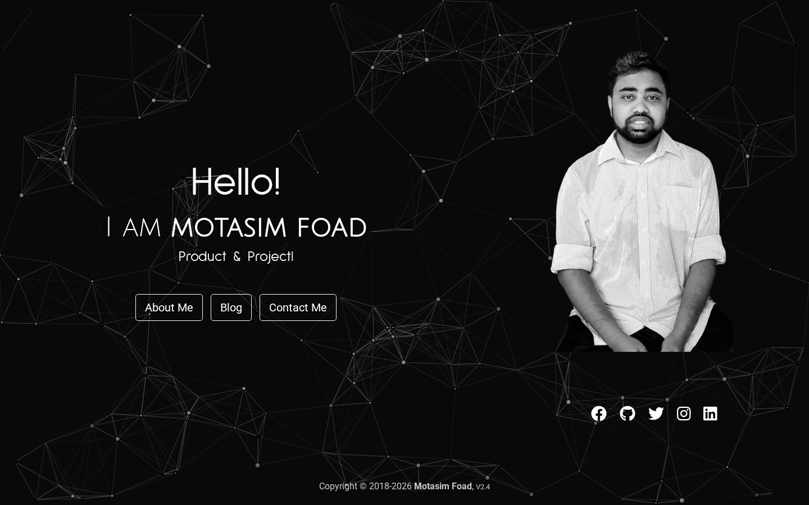
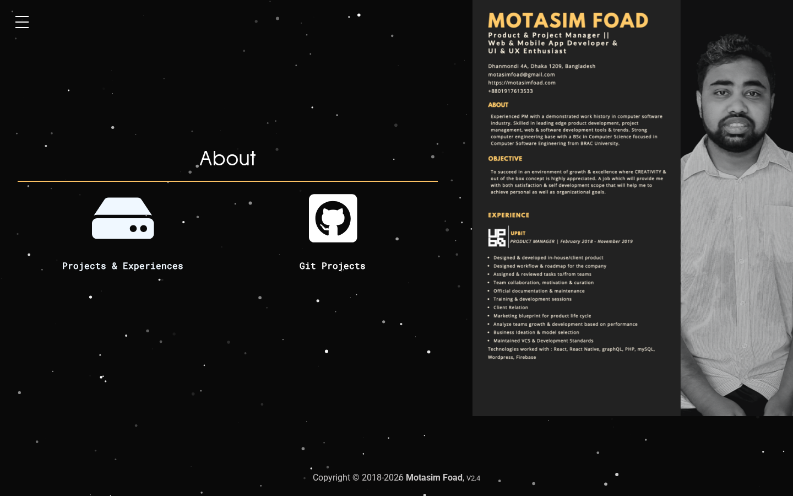
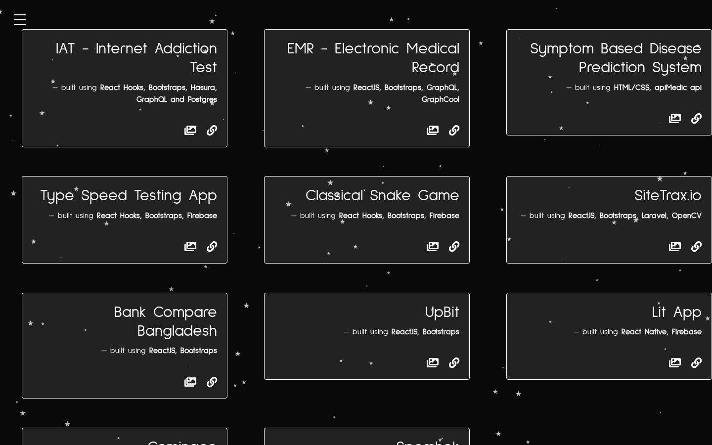
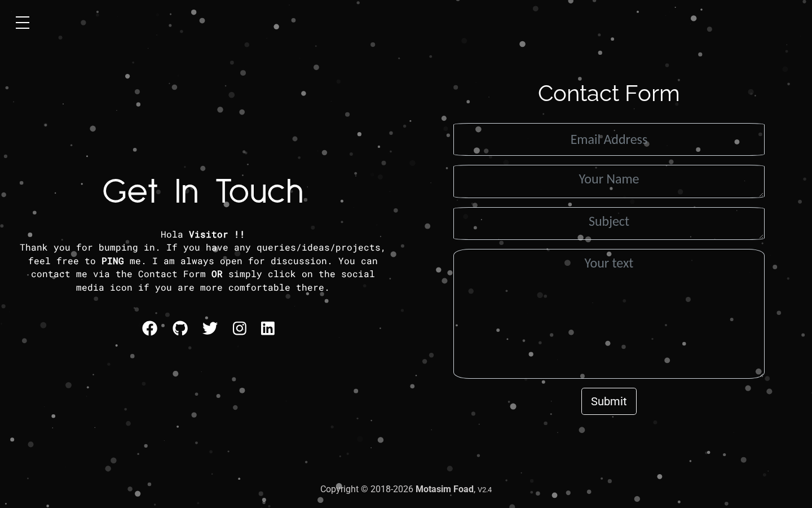
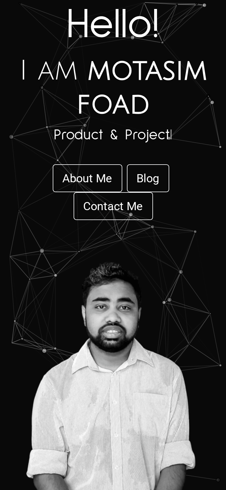

# Portfolio 2020

A personal portfolio template built with React, Bootstrap, Particles.js and EmailJS.

Live preview: https://motasimfoad.com



## Screenshots

| About | Projects |
| --- | --- |
|  |  |

| Contact | Mobile |
| --- | --- |
|  |  |

## Features

- Animated particle backgrounds on each page
- Home, About (CV), Projects and Contact pages
- Project cards with image lightbox galleries, driven by a single JSON file
- Contact form that sends email through EmailJS (no backend needed)
- Google Analytics page tracking
- Responsive layout with a hamburger menu on small screens

## Quick start

Tested with Node.js 20 and npm 10.

```bash
git clone https://github.com/motasimfoad/Portfolio-2020.git
cd Portfolio-2020
npm install --legacy-peer-deps
```

This project uses `react-scripts` 3.x, which needs the legacy OpenSSL provider on Node.js 17 and newer:

```bash
# macOS / Linux
NODE_OPTIONS=--openssl-legacy-provider npm start
NODE_OPTIONS=--openssl-legacy-provider npm run build

# Windows (PowerShell)
$env:NODE_OPTIONS="--openssl-legacy-provider"; npm start
```

On Node.js 16 or older you can run `npm start` and `npm run build` directly.

The dev server runs at http://localhost:3000. The production build is written to `build/`.

## Make it your own

| What to change | Where |
| --- | --- |
| Name, title and intro text | `src/components/home_left/index.js` |
| Profile photo and logo | `src/assets/img/` and `src/components/home_right/index.js` |
| About / CV content and images | `src/components/cv_left_content/`, `src/components/cv_img/`, `src/assets/img/cv*.png` |
| Projects list | `src/const/project_info.json` (name, tools, link and screenshot URLs) |
| Social links | `src/components/social_icons/index.js` |
| Footer text | `src/components/footer/index.js` |
| Page titles and meta tags | `react-helmet` blocks in `src/pages/*/index.js`, plus `public/index.html` and `public/manifest.json` |
| Particle backgrounds | `src/const/*particle.js` |
| Google Analytics ID | `ReactGA.initialize(...)` in `src/pages/*/index.js` |
| Sitemap | `public/sitemap.xml` |

### Contact form (EmailJS)

1. Create a free account at https://www.emailjs.com and add an email service and a template.
2. In `src/components/email_form/index.js`, replace the service ID, template ID and user ID passed to `emailjs.send(...)` with your own.
3. Update `to_name` in the same file to your email address.

Please do not reuse the IDs that ship with this repository; they belong to the original site.

## Deployment

Run the build command above and upload the `build/` folder to any static host (Netlify, Vercel, GitHub Pages, cPanel, etc.). Because the app uses client-side routing, configure your host to serve `index.html` for unknown paths. For hosting under a sub-path, set `homepage` in `package.json`. See the [Create React App deployment guide](https://create-react-app.dev/docs/deployment/).

## Notes

- `node-sass` was removed from the dependencies. The project has no Sass files, and `node-sass` 4.x fails to install on current Node.js versions.

## Contributing

Issues and pull requests are welcome. Please read [CONTRIBUTING.md](CONTRIBUTING.md) and the [Code of Conduct](CODE_OF_CONDUCT.md).

## License

[MIT](LICENSE)
